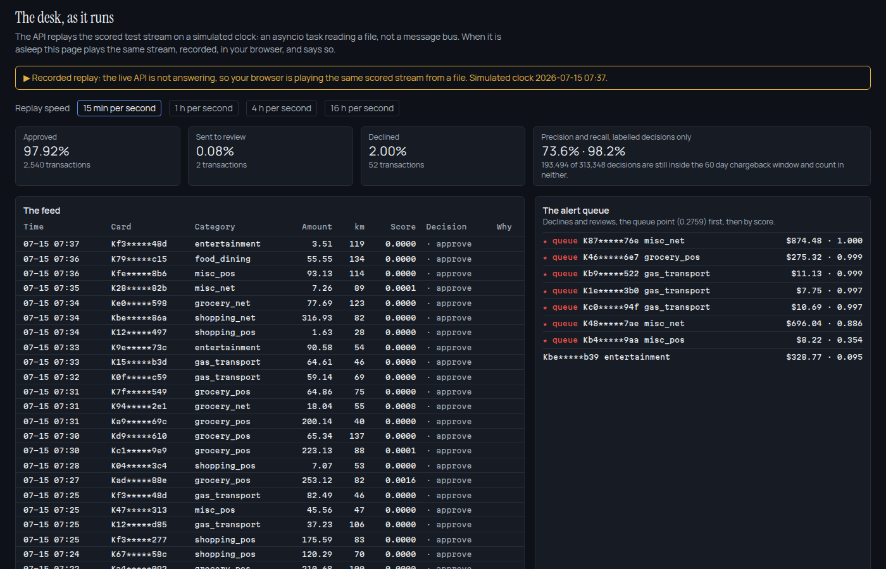

# ledger

The analytics function of a fictional retail bank: a live fraud desk, a credit scorecard studio, model risk management in the shape SR 11-7 asks for, and a general ledger that reconciles to the cent.

[](https://github.com/mekala27-45/ledger/actions/workflows/ci.yml)
[](https://mekala27-45.github.io/ledger/)



**Live site:** [mekala27-45.github.io/ledger](https://mekala27-45.github.io/ledger/) · **Every number:** [RESULTS.md](RESULTS.md) · **The board pack:** [report/board-pack.md](report/board-pack.md) · **Decisions and challenges:** [DECISIONS.md](DECISIONS.md)

> Harborline Bank is fictional. This is a demonstration on generated data and public datasets; no real customer, account or transaction of any real institution appears here.
>
> Nothing here is a credit decision, a fraud determination, a suspicious activity finding or investment advice.

The bank is Harborline Bank, and it does not exist: its name was checked against all 27,834 institutions in the FDIC directory, active and inactive, and a test in CI checks it again. Its 50,000 customers, their accounts and loans, 36 months of a general ledger, and the card transactions on the desk are generated with known truth. The peer banks, the macro series and the supervisory scenarios are real public data, and every figure says which it is.

## Results

| Measure | Result | How it was measured |
| --- | --- | --- |
| Ledger reconciliation | 786 of 792 account months tie to the cent; the one planted break found: account 2010, $4,217.36, from 2026-03 | Balances rebuilt from postings in exact decimals, no tolerance; every posting traced to its source |
| Sub ledger ties | 216 of 216 | Loan and deposit servicing records against the ledger, by account and month |
| Injected data defects caught | 3 of 3, each at its injected count | 16 data quality rules on every staged table |
| Fraud desk cost at the operating point | $24,927 against $1,573,327 for approving everything | Threshold 0.0503 chosen by expected cost on validation months, reported on the test months (June to August 2026) |
| Precision the desk can state on the as of date | 73.4% over labelled decisions; 27.0% if unlabelled declines are counted as mistakes | Labels arrive after a 60 day chargeback window |
| Application fraud under the BAF suite's protocol | Recall 49.0% at a 5% false positive rate; predictive equality between age groups 0.46 (base), 0.44 (variant II) | Age never a feature; the features still predict age 50 and over at AUROC 0.782, and the search for a less discriminatory alternative is published |
| Credit scorecard, out of time | AUROC 0.662, 8 of 13 characteristics | Weight of evidence, logistic, points scaled; validation report concludes approved with conditions |
| The same engine on real accounts | AUROC 0.768 on 30,000 UCI credit card accounts | Logistic on raw inputs 0.750 |
| Challenger | AUROC 0.005 better, not promoted | Monotone gradient boosting, shadow scored; below its promotion gate |
| Known risk structure recovered | 8 of 8 generator parameters within tolerance | Before any credit number was trusted |
| Against real peers | Net interest margin 5.60%, above 99% of 191 FDIC insured banks its size in its region | FDIC financial data, 2026Q2 |
| Fair lending on real HMDA data | Black applicants' odds of denial 1.76 times white non Hispanic applicants' after adjustment (2.63 before) | 215,881 New Jersey applications, lender fixed effects, Benjamini and Hochberg across 8 comparisons |
| Transaction monitoring | 362 of 422 planted laundering episodes found; 41.5% of structuring alerts real | Four rules at the reporting threshold, graded against the generator's truth |
| Deposit betas | 3 of 3 recovered within 0.02 of the generator's; time deposits passed on 0.32 of the first year's rate cuts | Offered rates from the rate sheet, paid rates from interest actually credited |
| Deposit attrition | AUROC 0.583 against a ceiling of 0.588 from the generator's own hazards | The logistic regression beat LightGBM on held out customers, so it is the model |
| Supervisory stress, the Fed's 2026 scenarios | Nine quarter losses $59.8M under severely adverse ($55.9M to $63.9M), $27.2M under baseline | A macro link that recovers the generator's sensitivity (0.215 against 0.30) before any path is projected |
| Rate sensitivity | Net interest income changes by -$6,981 after a two point rise and -$175,123 after a two point fall, over twelve months | Repricing gaps with the recovered deposit betas; the balance sheet is close to neutral |
| Warehouse | 210 of 210 tests pass over 62 models | dbt on DuckDB |

## The fraud desk

The API replays the scored test stream in time order on a simulated clock and pushes each decision to the browser over server sent events. It is a replay worker inside the API process, not a message bus. When the API is asleep, the page plays the same stream from a recorded file and says so on screen.

Every card transaction is scored at the moment it happens, from features computed only from earlier transactions; a test recomputes 200 sampled rows from scratch and requires the same values. The decline threshold is where the expected cost of false declines and missed fraud is lowest on the validation months, at $12.00 per false decline and each missed fraud's amount plus $35.00. Accuracy would have chosen 0.6376 and cost $89,153.

Fraud labels arrive when chargebacks do. On the as of date, 66.1% of the test stream's decisions were still inside the chargeback window, so the desk reports precision only over decisions old enough to be labelled and shows how many it cannot yet judge. A precision figure that ignores that window is not a number a fraud operations manager can use.

The model's AUROC of 1.000 is a property of the Sparkov generator, whose fraud barely overlaps genuine spending; the validation report says so beside the figure. What carries over to a real desk is the machinery around the score.

## The functions

| | Function | Question | Metric | Regulator or benchmark | Model | Page |
| --- | --- | --- | --- | --- | --- | --- |
| f01 | The bank at a glance | How is the bank doing, and against whom? | Net interest margin 5.60%, efficiency 50.9% | FDIC financial data for real peers | | [/](https://mekala27-45.github.io/ledger/) |
| f02 | Consumer lending | Is the installment book performing as priced, and what will it lose? | Expected loss $8,409,265 | CECL, illustrated and labelled simplified | `pd_scorecard`, `pd_challenger` | [/lending](https://mekala27-45.github.io/ledger/lending/) |
| f03 | Fair lending | Are some applicants denied more often than comparable applicants? | Adjusted odds ratio for Black applicants 1.76 | HMDA, ECOA and Regulation B | | [/fair-lending](https://mekala27-45.github.io/ledger/fair-lending/) |
| f04 | The fraud desk | At what score should the desk decline, and what can it say about its precision? | Cost $24,927 at the operating point | The card networks' chargeback window; the BAF suite's fairness protocol | `fraud_card`, `fraud_account` | [/desk](https://mekala27-45.github.io/ledger/desk/) |
| f05 | Financial crime | Do the rules find the planted typologies at a workable volume, and in what order? | 362 of 422 planted episodes found, 7.9 alerts per hundred thousand entries | BSA and the reporting threshold | `aml_triage` | [/crime](https://mekala27-45.github.io/ledger/crime/) |
| f06 | Deposits and customers | Where are the deposits, how much of a rate move reaches customers, and whom should the bank call? | The largest one percent of depositors hold 12.6% | Deposit betas against the generator's | `attrition` | [/deposits](https://mekala27-45.github.io/ledger/deposits/) |
| f08 | Treasury and stress testing | What does a rate move do to earnings, and a severe recession to losses and capital? | Severely adverse losses $59.8M over nine quarters | The Federal Reserve's 2026 scenarios | | [/treasury](https://mekala27-45.github.io/ledger/treasury/) |
| f10 | Model risk management | Has every model earned the decisions it makes? | 6 models, each with a validation report | SR 11-7 | | [/models](https://mekala27-45.github.io/ledger/models/) |
| f11 | Controls and data | Can every other number be trusted? | 786 of 792 account months tied | Ledger to sub ledger, to the cent | | [/controls](https://mekala27-45.github.io/ledger/controls/) |
| f12 | The board pack | What should the board decide? | Installment cutoff held at 580 | | | [/report](https://mekala27-45.github.io/ledger/report/) |

The scorecard studio at [/studio](https://mekala27-45.github.io/ledger/studio/) rebins any characteristic in the browser, recomputes weight of evidence, information value and monotonicity as the edges move, and scores an applicant with the adverse action reasons Regulation B requires. The browser's arithmetic is tested against the API's on the same applicants.

## Skills, and where each one lives

| Skill | Where it lives |
| --- | --- |
| Credit scorecards, weight of evidence and information value | `packages/scorecard`, [/studio](https://mekala27-45.github.io/ledger/studio/) |
| PD, LGD, EAD and expected loss | `packages/functions/.../f02_lending`, `docs/definitions.md` |
| Vintage and roll rate analysis | f02, [/lending](https://mekala27-45.github.io/ledger/lending/) |
| CECL style provisioning | f02, labelled simplified where it is used |
| Survival analysis | f02, Kaplan Meier and Cox with the proportional hazards test |
| Champion and challenger | `packages/models`, the registry, the promotion gates |
| Fraud detection with a cost based operating point | f04, `packages/desk`, [/desk](https://mekala27-45.github.io/ledger/desk/) |
| Streaming and real time scoring | `packages/desk`, `packages/api`, the SSE stream |
| Late labels and censoring | `ledger_core.calendar`, the desk's labelled panel |
| Fair lending, HMDA and Regulation B | f03, `packages/fairness`, [/fair-lending](https://mekala27-45.github.io/ledger/fair-lending/), `docs/fair-lending.md` |
| Anti money laundering typologies | f05, `rules/aml_typologies.yaml`, `packages/crime` |
| Graph analytics | f05, the transfer network, [/crime](https://mekala27-45.github.io/ledger/crime/) |
| Adverse action reason codes | `packages/scorecard`, the studio |
| Fairness in fraud and credit | subgroup audits in every validation report; the BAF protocol and a less discriminatory alternative search in `report/validation/fraud_account.md` |
| Deposit betas and customer attrition | f06, [/deposits](https://mekala27-45.github.io/ledger/deposits/) |
| Interest rate risk, stress testing and liquidity | f08, `packages/stress`, [/treasury](https://mekala27-45.github.io/ledger/treasury/) |
| Model risk management, SR 11-7 | f10, `report/validation`, [/models](https://mekala27-45.github.io/ledger/models/) |
| Model monitoring, PSI and CSI | f10, the monitoring charts |
| Ledger reconciliation and controls | f11, [/controls](https://mekala27-45.github.io/ledger/controls/) |
| Data quality and contracts | `packages/contracts`, pandera schemas, quarantine by rule |
| SQL, dbt and analytics engineering | `warehouse/`, `metrics/`, [/explore](https://mekala27-45.github.io/ledger/explore/) |
| Visualization | `web/`, a validated palette in both themes, a callout on every chart |
| Communication | `report/board-pack.md`, the examiner paragraph on every page |
| CI, containers and gates | `.github/workflows`, `Dockerfile.api`, `scripts/` |

## How the numbers are kept honest

- **One manifest.** Every figure in this README, RESULTS, the board pack and every validation report is rendered from `results/manifest.json` by a template. CI re-renders them and fails on any difference, and fails on any number typed into a template by hand.
- **Known truth first.** The generators plant their parameters, typologies, defects and one ledger break at stated values, and the pipeline has to find each before its other numbers are used.
- **Thresholds on validation, results on test.** Every operating point is chosen on data the reported result never saw.
- **Point in time.** Every model states its prediction time, and a leakage test recomputes sampled rows from scratch.
- **Gates.** No em dashes, no marketing vocabulary, both statements on every surface, the bank name checked against the FDIC directory, and a scan of every published file for card numbers, Social Security numbers and the generator's person names.

## Run it

```
make setup          # uv sync and the site's npm install
make fetch          # checks the real datasets against data/PROVENANCE.md, says how to get any missing
make pipeline       # generate, contracts, warehouse, reconcile, metrics, models, functions, render
make gates          # every gate CI runs
make web            # the static site into web/out
```

The API runs with `uv run uvicorn ledger_api.main:app` against Postgres; `DATABASE_URL`, `LEDGER_API_TOKEN` and `LEDGER_CORS_ORIGINS` configure it. The site works without it, from the committed bundle and the recorded replay.

## Limitations

- The customers, loans, ledger and card stream are generated. They carry real structure because the generator states it, but no number about them is a number about a real bank.
- The fraud model separates Sparkov's fraud almost perfectly; real card fraud imitates genuine spending and would not.
- The scorecard under predicts default on the vintages written under a loosened cutoff; expected loss applies an observed to expected overlay, and the validation report concludes approved with conditions.
- Risk weights, the capital ratio and the CECL illustration are simplified, and each is labelled so where it appears.
- There is no authentication beyond a token on the case and score endpoints, because this is a demonstration.

## How this was built

Built with Claude as a pair programmer, over one long working session. The design, the scope and every call about method and trade off are mine; Claude wrote most of the implementation and the tests, and the commit history is left as it happened, trailers included. `DECISIONS.md` records what was challenged along the way and what changed because of it.

## Licence

Code under Apache 2.0. Every dataset's source, date and licence is in [data/PROVENANCE.md](data/PROVENANCE.md).
